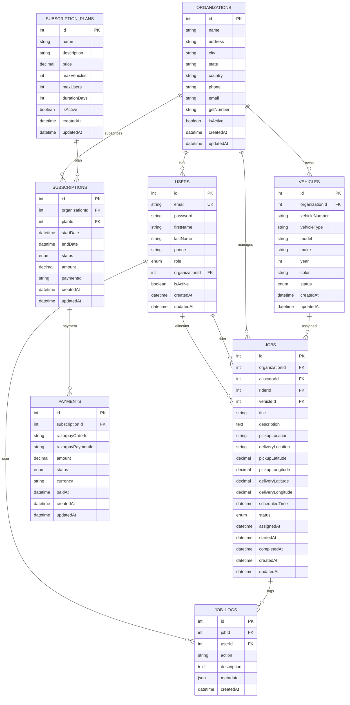

# ZipSureAI Database Schema & Relationships

## 📊 Entity Relationship Diagram



## 🗄️ Database Tables

### 1. Users Table
```sql
CREATE TABLE users (
    id SERIAL PRIMARY KEY,
    email VARCHAR(255) UNIQUE NOT NULL,
    password VARCHAR(255) NOT NULL,
    firstName VARCHAR(100) NOT NULL,
    lastName VARCHAR(100) NOT NULL,
    phone VARCHAR(20),
    role ENUM('superadmin', 'admin', 'allocator', 'rider') NOT NULL,
    organizationId INTEGER REFERENCES organizations(id),
    isActive BOOLEAN DEFAULT true,
    createdAt TIMESTAMP DEFAULT CURRENT_TIMESTAMP,
    updatedAt TIMESTAMP DEFAULT CURRENT_TIMESTAMP
);
```

### 2. Organizations Table
```sql
CREATE TABLE organizations (
    id SERIAL PRIMARY KEY,
    name VARCHAR(255) NOT NULL,
    address TEXT,
    city VARCHAR(100),
    state VARCHAR(100),
    country VARCHAR(100),
    phone VARCHAR(20),
    email VARCHAR(255),
    gstNumber VARCHAR(50),
    isActive BOOLEAN DEFAULT true,
    createdAt TIMESTAMP DEFAULT CURRENT_TIMESTAMP,
    updatedAt TIMESTAMP DEFAULT CURRENT_TIMESTAMP
);
```

### 3. Subscription Plans Table
```sql
CREATE TABLE subscription_plans (
    id SERIAL PRIMARY KEY,
    name VARCHAR(100) NOT NULL,
    description TEXT,
    price DECIMAL(10,2) NOT NULL,
    maxVehicles INTEGER NOT NULL,
    maxUsers INTEGER NOT NULL,
    durationDays INTEGER NOT NULL,
    isActive BOOLEAN DEFAULT true,
    createdAt TIMESTAMP DEFAULT CURRENT_TIMESTAMP,
    updatedAt TIMESTAMP DEFAULT CURRENT_TIMESTAMP
);
```

### 4. Subscriptions Table
```sql
CREATE TABLE subscriptions (
    id SERIAL PRIMARY KEY,
    organizationId INTEGER REFERENCES organizations(id),
    planId INTEGER REFERENCES subscription_plans(id),
    startDate TIMESTAMP NOT NULL,
    endDate TIMESTAMP NOT NULL,
    status ENUM('active', 'expired', 'cancelled', 'pending') DEFAULT 'pending',
    amount DECIMAL(10,2) NOT NULL,
    paymentId VARCHAR(255),
    createdAt TIMESTAMP DEFAULT CURRENT_TIMESTAMP,
    updatedAt TIMESTAMP DEFAULT CURRENT_TIMESTAMP
);
```

### 5. Vehicles Table
```sql
CREATE TABLE vehicles (
    id SERIAL PRIMARY KEY,
    organizationId INTEGER REFERENCES organizations(id),
    vehicleNumber VARCHAR(50) NOT NULL,
    vehicleType VARCHAR(50),
    model VARCHAR(100),
    make VARCHAR(100),
    year INTEGER,
    color VARCHAR(50),
    status ENUM('active', 'inactive', 'maintenance') DEFAULT 'active',
    createdAt TIMESTAMP DEFAULT CURRENT_TIMESTAMP,
    updatedAt TIMESTAMP DEFAULT CURRENT_TIMESTAMP
);
```

### 6. Jobs Table
```sql
CREATE TABLE jobs (
    id SERIAL PRIMARY KEY,
    organizationId INTEGER REFERENCES organizations(id),
    allocatorId INTEGER REFERENCES users(id),
    riderId INTEGER REFERENCES users(id),
    vehicleId INTEGER REFERENCES vehicles(id),
    title VARCHAR(255) NOT NULL,
    description TEXT,
    pickupLocation TEXT NOT NULL,
    deliveryLocation TEXT NOT NULL,
    pickupLatitude DECIMAL(10,8),
    pickupLongitude DECIMAL(11,8),
    deliveryLatitude DECIMAL(10,8),
    deliveryLongitude DECIMAL(11,8),
    scheduledTime TIMESTAMP,
    status ENUM('assigned', 'accepted', 'in_progress', 'completed', 'cancelled') DEFAULT 'assigned',
    assignedAt TIMESTAMP,
    startedAt TIMESTAMP,
    completedAt TIMESTAMP,
    createdAt TIMESTAMP DEFAULT CURRENT_TIMESTAMP,
    updatedAt TIMESTAMP DEFAULT CURRENT_TIMESTAMP
);
```

### 7. Payments Table
```sql
CREATE TABLE payments (
    id SERIAL PRIMARY KEY,
    subscriptionId INTEGER REFERENCES subscriptions(id),
    razorpayOrderId VARCHAR(255),
    razorpayPaymentId VARCHAR(255),
    amount DECIMAL(10,2) NOT NULL,
    status ENUM('pending', 'completed', 'failed', 'refunded') DEFAULT 'pending',
    currency VARCHAR(3) DEFAULT 'INR',
    paidAt TIMESTAMP,
    createdAt TIMESTAMP DEFAULT CURRENT_TIMESTAMP,
    updatedAt TIMESTAMP DEFAULT CURRENT_TIMESTAMP
);
```

### 8. Job Logs Table
```sql
CREATE TABLE job_logs (
    id SERIAL PRIMARY KEY,
    jobId INTEGER REFERENCES jobs(id),
    userId INTEGER REFERENCES users(id),
    action VARCHAR(100) NOT NULL,
    description TEXT,
    metadata JSON,
    createdAt TIMESTAMP DEFAULT CURRENT_TIMESTAMP
);
```

## 🔗 Relationships

### One-to-Many Relationships
- **Organization → Users**: One organization can have multiple users
- **Organization → Vehicles**: One organization can have multiple vehicles
- **Organization → Jobs**: One organization can have multiple jobs
- **Organization → Subscriptions**: One organization can have multiple subscriptions
- **Subscription Plan → Subscriptions**: One plan can have multiple subscriptions
- **Subscription → Payments**: One subscription can have multiple payments
- **User → Jobs (as Allocator)**: One allocator can assign multiple jobs
- **User → Jobs (as Rider)**: One rider can handle multiple jobs
- **Vehicle → Jobs**: One vehicle can be assigned to multiple jobs
- **Job → Job Logs**: One job can have multiple logs

### Many-to-One Relationships
- **Users → Organization**: Multiple users belong to one organization
- **Vehicles → Organization**: Multiple vehicles belong to one organization
- **Jobs → Organization**: Multiple jobs belong to one organization
- **Subscriptions → Organization**: Multiple subscriptions belong to one organization
- **Subscriptions → Subscription Plan**: Multiple subscriptions can use the same plan
- **Payments → Subscription**: Multiple payments can be made for one subscription
- **Jobs → User (Allocator)**: Multiple jobs can be assigned by one allocator
- **Jobs → User (Rider)**: Multiple jobs can be handled by one rider
- **Jobs → Vehicle**: Multiple jobs can be assigned to one vehicle
- **Job Logs → Job**: Multiple logs can be created for one job

## 📊 Indexes

### Primary Indexes
- All tables have `id` as primary key with auto-increment

### Unique Indexes
- `users.email` - Unique email constraint
- `organizations.gstNumber` - Unique GST number per organization
- `vehicles.vehicleNumber` - Unique vehicle number per organization

### Foreign Key Indexes
- `users.organizationId`
- `subscriptions.organizationId`
- `subscriptions.planId`
- `vehicles.organizationId`
- `jobs.organizationId`
- `jobs.allocatorId`
- `jobs.riderId`
- `jobs.vehicleId`
- `payments.subscriptionId`
- `job_logs.jobId`
- `job_logs.userId`

### Performance Indexes
- `jobs.status` - For filtering jobs by status
- `jobs.scheduledTime` - For date-based queries
- `subscriptions.status` - For active subscription queries
- `users.role` - For role-based queries
- `payments.status` - For payment status queries

## 🔄 Data Flow

### User Registration Flow
1. User registers with email/password
2. System creates user record with default role
3. User is assigned to organization (if admin creates)
4. User can login and access role-specific features

### Job Allocation Flow
1. Allocator creates new job
2. System assigns job to available rider
3. Rider receives notification
4. Rider accepts/rejects job
5. Job status updates through completion

### Subscription Flow
1. Admin selects subscription plan
2. System creates payment order via Razorpay
3. Admin completes payment
4. System activates subscription
5. Organization gets access to plan features

### Analytics Flow
1. System aggregates data from various tables
2. Role-specific dashboards are generated
3. Real-time updates via WebSocket connections
4. Historical data for trend analysis

## 🛡️ Security Considerations

### Data Protection
- Passwords are hashed using bcrypt
- JWT tokens for authentication
- Role-based access control
- Input validation and sanitization

### Database Security
- Foreign key constraints for data integrity
- Unique constraints where appropriate
- Proper indexing for performance
- Regular backups recommended

### API Security
- Rate limiting on endpoints
- CORS configuration
- Helmet.js for security headers
- Input validation middleware 